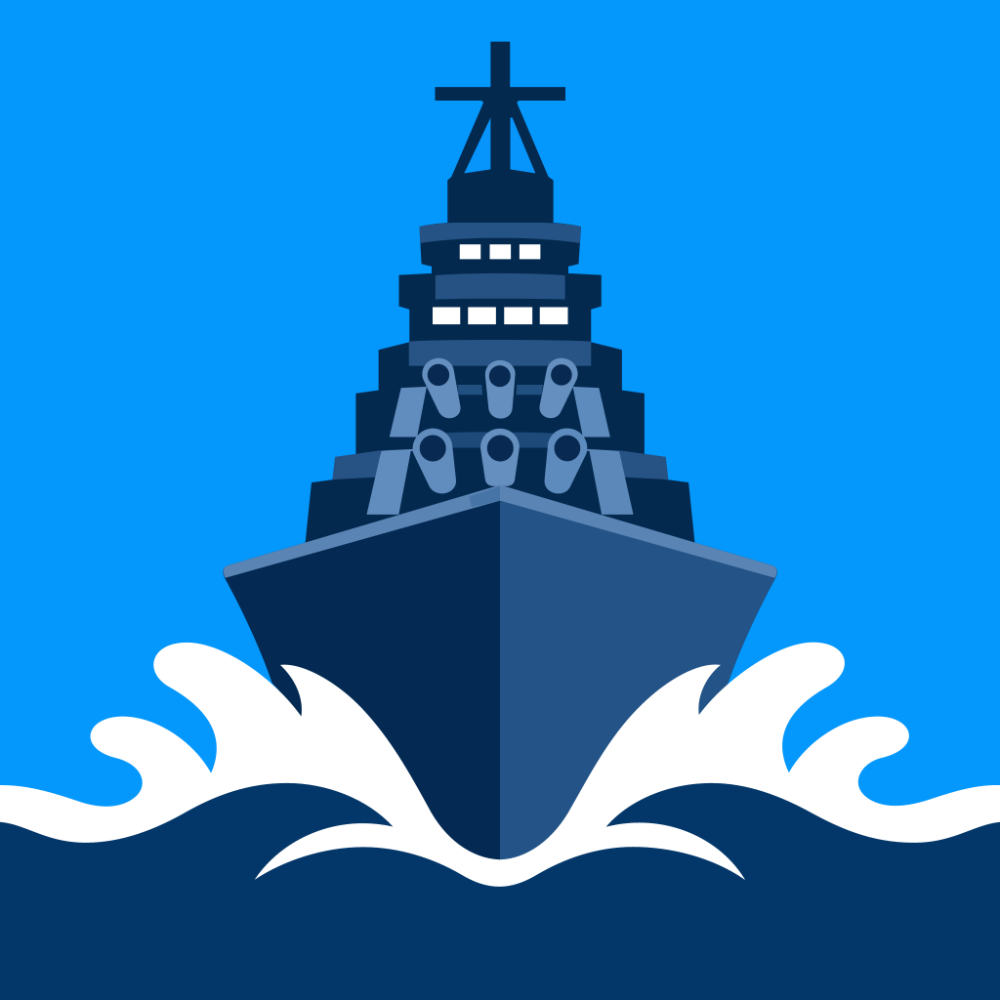

  

<h1 align="center">
  WoWs Insight
</h1>

  一个原生的 iOS 端战舰世界战绩查询工具。

## 功能

- 在俄服 / 欧服 / 美服 / 亚服 / 国服之间切换
- 按昵称搜索玩家
- 玩家总览
  - 按战斗类型（随机战 / 排位战 / 联合作战 / 公会战 …）切换，默认显示随机战
  - 胜率、战斗场数、平均伤害、平均击杀、平均经验、生存率
  - 详细数据：胜负平、总伤害、总经验、命中率、KD、潜在伤害、侦查伤害、侦测、击落飞机等
  - 最高记录：最高伤害、最多击杀、最多经验、最多击落飞机、最多侦测、最大潜在伤害、最大侦查伤害，并显示对应的战舰
  - 个人评分
- 战舰列表
  - 按场数 / 胜率 / 平均伤害 / 评分 / 最近战斗排序
  - 显示战舰等级、类型、场数、胜率、个人评分、平均伤害
  - 点进单艘战舰查看同样的统计与记录
- 收藏
  - 玩家页右上角星标可收藏 / 取消收藏
  - 搜索结果的左滑菜单也可以直接收藏
  - 收藏的账号会显示在首页，左滑可取消收藏
  - 首页右上角「⋯」菜单里选「编辑」可拖动调整收藏顺序，或在编辑模式下逐条删除
  - 同一个「⋯」菜单可以把收藏导出成 JSON 文件，或在另一台设备上导入
- 多语言，包括：简体中文 / 繁體中文 / English / 日本語 / 한국어

## 运行

- 需要 iOS 18.0+ 的设备或模拟器；源码需要用 Xcode 16 或更新版本自行构建。
- 在 Target → Signing & Capabilities 里选择自己的 Team，按需修改 Bundle Identifier 后运行。

## 个人评分怎么看

评分由 Yuyuko API 按 wows-numbers 的公开算法、结合各服务器自己的期望值算出，0 – 9999 分：

| 分数        | 含义     | 颜色      |
| ----------- | -------- | --------- |
| 0 – 749     | 还需努力 | `#D32F2F` |
| 750 – 1099  | 低于平均 | `#FF9800` |
| 1100 – 1349 | 平均水平 | `#FFB300` |
| 1350 – 1549 | 好       | `#7CB342` |
| 1550 – 1749 | 很好     | `#388E3C` |
| 1750 – 2099 | 非常好   | `#03A9F4` |
| 2100 – 2449 | 大佬平均 | `#9C27B0` |
| 2450+       | 神佬平均 | `#673AB7` |

> 数据来自社区的 Yuyuko API，仅供参考。

## 已知限制

- 收藏只保存在本机，没有云同步和自动备份；卸载 App 会丢失，需要手动导出 JSON 备份。
- 目前提供简体中文、繁体中文、英语、日语和韩语五种界面语言；其他语言未单独翻译，由 iOS 自动回退。
- 接口只提供简体的战舰译名，所以繁体中文界面里的舰名仍是简体；日语和韩语界面里的舰名显示英文名。
- 只支持玩家昵称搜索，不支持按账号 ID 直接搜索；国服（360）只支持完整昵称精确匹配。
- 隐藏战绩的账号只能显示昵称和注册 / 最后战斗时间。
- 未查询过的玩家首次打开需要 6–8 秒（服务端要回源拉取数据），之后同一玩家会快很多。

## 声明

本工程与 Wargaming、wows-numbers、Yuyuko 均没有官方关系。

数据由第三方服务 [Yuyuko](https://wows.shinoaki.com/) 提供。
